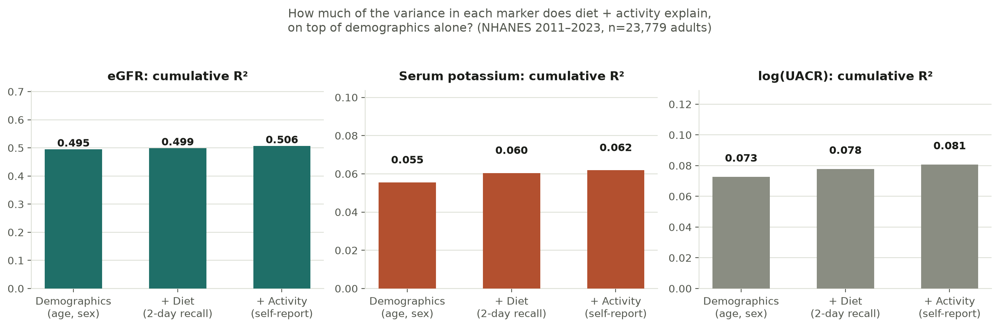
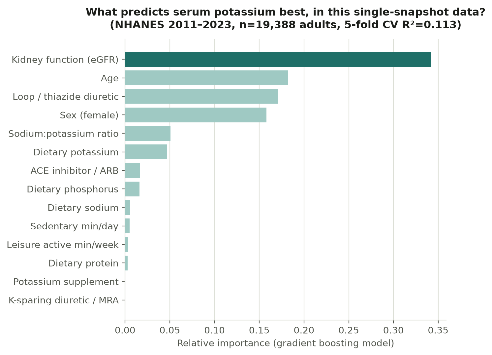

# Does diet and activity predict kidney markers?

A variance-decomposition study on five pooled cycles of NHANES (2011–2018 and
2021–2023, **n = 23,779 adults**; CKD subgroup n = 1,839), testing how much diet and physical
activity explain three kidney markers: eGFR, serum potassium, and urine
albumin:creatinine ratio (UACR).

**Short answer: much less than a behaviour-change product would need.** Diet and
activity add roughly 0.01 R² to eGFR beyond age and sex, and essentially nothing
among people who already have CKD. The mechanism is real — dietary potassium
independently predicts serum potassium even after controlling for kidney function
and potassium-affecting medications — but a between-person snapshot cannot forecast
an individual's trajectory. That is the case for longitudinal tracking, and it is
the question this repo was built to settle.



*Demographics dominate. Adding two days of dietary recall, then self-reported
leisure-time activity, moves R² very little.*

---

## Key findings

**eGFR** — dominated by age (96% of gradient-boosting importance). Diet adds
+0.004 R², activity +0.008, against a demographics-only baseline of R² = 0.495. In
the CKD subgroup, 5-fold CV R² = −0.002 (±0.027): diet and activity explain
essentially none of the variation among people who already have reduced kidney
function. With 1,839 CKD patients this is a real cross-sectional result rather than
a sample-size artifact.

**Serum potassium** — the clearest signal. Dietary potassium remains a significant,
positive predictor (p < 0.001) after controlling for eGFR *and* medications.
Medications behave as physiology predicts: loop/thiazide diuretics lower serum K
(−0.20 mmol/L), ACE inhibitors and ARBs raise it (+0.06 mmol/L). Gradient boosting
reaches CV R² = 0.113 overall and 0.027 in CKD.



**UACR** — the marker most linked to modifiable behaviour. Higher potassium intake
and more activity both associate with lower UACR. Within CKD patients, dietary
sodium and the Na:K ratio are the top dietary features.

Full write-up, including what changed in the 2021–2023 cycle and the comparison
against earlier passes: **[`data/FINDINGS.md`](data/FINDINGS.md)**.

---

## Method

eGFR is computed with the **race-free 2021 CKD-EPI creatinine equation**. Diet is the
mean of the day-1 and day-2 recalls where both are reliable (88% of participants),
day 1 alone otherwise, which reduces day-to-day intake noise. Activity is
leisure-time activity, the only measure asked in all five cycles (2021–2023 dropped
the work-activity questions). Medication flags are derived from the prescription
file: ACE inhibitor/ARB, K-sparing diuretic/MRA, loop/thiazide diuretic, potassium
supplement. The public 2021–2023 file has no drug names, so models that include
medications use 2011–2018 only.

Models are OLS variance decomposition (demographics → +diet → +activity) alongside
gradient boosting with 5-fold cross-validation, run both overall and on the CKD
subgroup (eGFR < 60).

**Caveat:** models are unweighted. The pooled MEC weight (`WTMEC_POOLED`) is
carried in the dataset for survey-weighted estimates but is not yet applied, so these
results describe the analysed sample rather than the US population.

| Script | Does |
|---|---|
| `01_build_dataset.py` | Merges seven raw files per cycle on `SEQN`, stacks five cycles, computes eGFR, derives weekly activity minutes (both questionnaire versions), adds UACR and medication flags. |
| `02_analyze.py` | OLS variance decomposition and gradient boosting with 5-fold CV for all three markers. |
| `03_plots.py` | Renders the figures above. |

---

## Food database

`04_build_food_db.py` builds `data/food.db`, a SQLite database of **13,620 foods**
with the nutrients that matter in CKD (potassium, sodium, phosphorus, protein,
calcium, energy, water) per 100 g, plus household portions with gram weights
(for example, a medium banana is 118 g and 422 mg potassium). It is the nutrient
source for food logging in the planned app.

| Source (USDA FoodData Central) | Foods | Notes |
|---|---|---|
| SR Legacy (2018) | 7,793 | Classic USDA reference foods, most complete nutrient coverage |
| FNDDS 2021–2023 (2024 release) | 5,432 | The food database behind NHANES 2021–2023 recalls; carries the FNDDS food code |
| Foundation Foods (2026) | 395 | Newer lab-analyzed values; some foods report only a few nutrients |

Tables: `foods`, `nutrients`, `food_nutrients` (one row per food and nutrient),
`portions`, and a `food_kidney` view with one row per food and the nutrients as
columns. Example queries, with T-SQL notes, are in
[`sql/food_queries.sql`](sql/food_queries.sql).

To rebuild, download the three CSV releases from the
[FoodData Central download page](https://fdc.nal.usda.gov/download-datasets/)
(Foundation Foods 04/2026, SR Legacy 04/2018, FNDDS 10/2024), unzip them into
`raw/fdc/`, and run `python 04_build_food_db.py`. FoodData Central data are public
domain (CC0).

---

## Reproducing

Raw `.XPT` files are not committed — they are a few MB each and easy to re-download.
Fetch these seven files per cycle from
`https://wwwn.cdc.gov/Nchs/Data/Nhanes/Public/<year>/DataFiles/<FILE>.xpt` into `raw/`
(the folder is the first year of the cycle, e.g. `.../Public/2017/DataFiles/DEMO_J.xpt`):

| Component | 2021–2023 | 2017–2018 | 2015–2016 | 2013–2014 | 2011–2012 |
|---|---|---|---|---|---|
| Demographics | DEMO_L | DEMO_J | DEMO_I | DEMO_H | DEMO_G |
| Diet, day 1 totals | DR1TOT_L | DR1TOT_J | DR1TOT_I | DR1TOT_H | DR1TOT_G |
| Diet, day 2 totals | DR2TOT_L | DR2TOT_J | DR2TOT_I | DR2TOT_H | DR2TOT_G |
| Standard biochemistry | BIOPRO_L | BIOPRO_J | BIOPRO_I | BIOPRO_H | BIOPRO_G |
| Physical activity | PAQ_L | PAQ_J | PAQ_I | PAQ_H | PAQ_G |
| Urine albumin & creatinine | ALB_CR_L | ALB_CR_J | ALB_CR_I | ALB_CR_H | ALB_CR_G |
| Prescription medications | RXQ_RX_L | RXQ_RX_J | RXQ_RX_I | RXQ_RX_H | RXQ_RX_G |

```bash
pip install -r requirements.txt
python 01_build_dataset.py
python 02_analyze.py
python 03_plots.py
```

---

## Data source and use

[NHANES](https://www.cdc.gov/nchs/nhanes/) (National Health and Nutrition Examination
Survey), U.S. CDC/NCHS. Public domain — no commercial-use restriction, only the
standard confidentiality terms: no re-identification, no linking to identify
individuals, cite the source.

Other CKD research datasets considered during planning (CRIC, Look AHEAD and MDRD via
the NIDDK Central Repository; UK Biobank) carry data-use agreements that restrict
commercial redistribution. Read those closely before relying on them for anything
beyond research validation.
